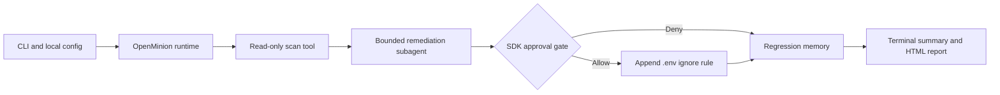

# Implementation guide

MinionAudit owns a bounded audit workflow while OpenMinion owns model execution, tool dispatch, policy approval, delegated context, sessions, and durable memory services.

## Module boundaries

| File | Responsibility |
| --- | --- |
| [`cli.py`](../minion_audit/cli.py) | Arguments, local environment loading, scan/inspect commands, output, exit status. |
| [`agent.py`](../minion_audit/agent.py) | Runtime lifecycle, decorated tools, bounded reviewer, approval callback, memory comparison, snapshots, diagnostics. |
| [`tools.py`](../minion_audit/tools.py) | Bounded directory traversal, secret redaction, regex/AST checks, stable finding fingerprints, deterministic ignore-file edit. |
| [`report.py`](../minion_audit/report.py) | Escaped single-file HTML, inline filtering, JSON companion. |
| [`agents.json`](../agents.json) | NIM endpoint/model, named agent profile, console channel, ask policy. |

## Data and permissions

The application binds the canonical target directory before exposing its scanner tool. The tool takes no model-supplied path. Whole source files remain local; the model receives finding metadata and redacted source snippets, with a 100-candidate review cap.

The child reviewer receives no tools and no delegated memory grant. Its procedure comes from an explicitly retrieved version of the bundled SDK skill. The application records that selection without claiming automatic promotion.

The fix tool also takes no arguments. Its only operation appends a literal `.env` line to the bound target's `.gitignore`. The SDK ask policy invokes the application callback, which displays the exact target and asks for a terminal decision. Unknown requests, unexpected arguments, and EOF are denied. Symlink traversal and hard-linked ignore files are refused by the edit helper.

## State and comparison

Run snapshots are written to `.minion_audit/runs/<session>.json`. SDK state is rooted under `.minion_audit/`; some provider bootstrap assets may also appear under ignored `.openminion/`.

The baseline stores finding fingerprints under a scope derived from the normalized canonical repository path. Fingerprints combine the rule, relative path, redacted snippet, and duplicate occurrence. Moving a finding down a few lines does not create a new issue. A changed snippet or relative path can produce a new fingerprint.

Comparisons describe the pre-fix scan. A scan with coverage warnings cannot replace the baseline or report unobserved candidates as resolved. Failure snapshots and failed reports preserve their actual status.

## Runtime contract

The integration uses the inspected SDK 0.1.22 APIs. Exact structured baseline access and skill ingestion use lower-level SDK services; changes to those services need version-specific review. The application verifies that the scanner actually ran, because a completed model turn with zero tools is insufficient evidence of a completed audit.

See [NOTES.md](../NOTES.md) for configuration errors, channel defaults, draft skill retrieval, model retirement, empty provider responses, and orchestration overhead observed during implementation.
